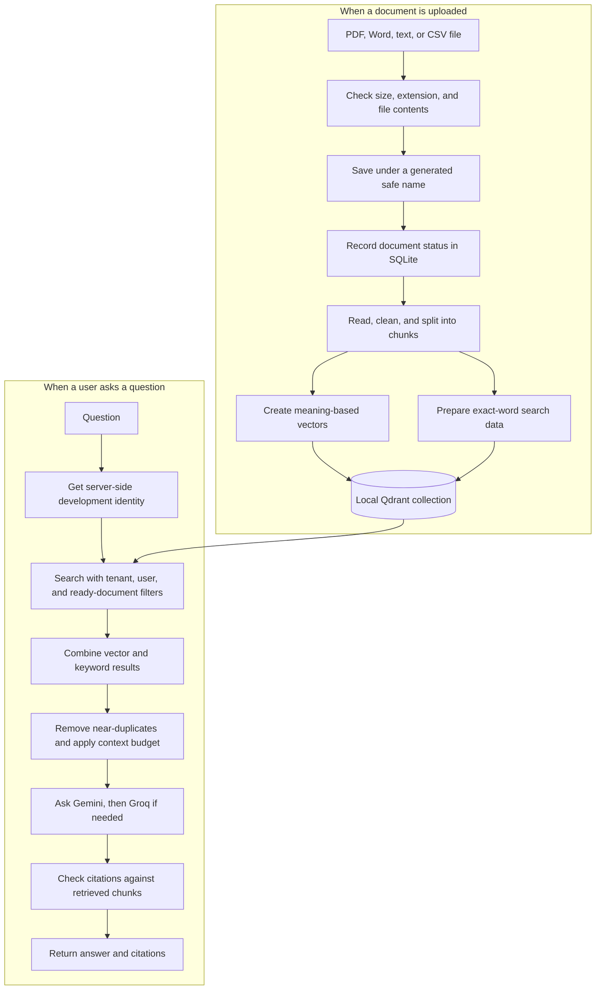

# Production RAG Knowledge Assistant

Ask questions about your documents and get answers grounded in those documents, with citations that show where the information came from.

Think of the app as a librarian. You give it files, it organizes their contents, and when you ask a question it finds useful passages and points back to them. If it cannot support an answer with the documents, it should say so.

> **Project status:** This is an actively developed local prototype. It has working ingestion, retrieval, a FastAPI API, and tests. It is not deployed, and the end-to-end latency target has not been demonstrated.

## What happens to a question?



**In simple words:** the app checks who is asking, looks only through that user's ready documents, chooses a small set of useful passages, asks an AI model to answer from those passages, and checks that each citation points to a passage it actually retrieved.

## Why this project exists

Many RAG demos can find text, but a useful document assistant also needs to handle unsafe files, failed processing, duplicate uploads, access boundaries, citations, provider outages, and measurable retrieval quality. This project is being built to learn and demonstrate those engineering pieces with tests and honest measurements.

RAG means **retrieval-augmented generation**: the app retrieves relevant document passages first, then gives those passages to a language model as evidence for its answer.

### A few technical words, simply explained

| Term | Plain meaning |
|---|---|
| Chunk | A small piece cut from a document so the app can search it. |
| Embedding or vector | A list of numbers that represents the meaning of a piece of text, so similar meanings can be searched. |
| BM25 | A method for ranking passages that contain the question's words. |
| Hybrid search | Uses both meaning-based vector search and exact-word search. |
| Reciprocal Rank Fusion (RRF) | Combines the two ranked result lists; a passage ranked highly by both searches can rise to the top. |
| Token budget | A limit on how much question-and-document text is sent to the AI model. |
| LRU cache | A small memory shelf that removes the answer that has gone unused for the longest time when the shelf is full. |
| Tenant and user | A tenant is a workspace or organization; a user is one person inside it. Both are checked when searching. |

## What is implemented

| Area | Current implementation |
|---|---|
| File reading | PDF, DOCX, TXT, and CSV loaders; content and extension checks; empty or unreadable files are reported as skipped |
| Uploads | FastAPI upload endpoint; 25 MiB limit; generated storage names; original filename retained as a display label |
| Document processing | Background processing with queued, processing, ready, and failed statuses; duplicate detection by file hash; version replacement and delete support |
| Local persistence | Files under `data/uploads/`, SQLite status records, and local Qdrant storage |
| Access isolation | Search filters enforce tenant, role, user ownership, private or tenant-shared visibility, and ready document IDs inside each Qdrant search request |
| Retrieval | Dense vector search, BM25 keyword search, and hybrid Reciprocal Rank Fusion (RRF) |
| Answering | Gemini primary provider and Groq backup, with timeouts, retries, growing waits, and a friendly unavailable message |
| Context control | Rank-ordered context selection within a token budget and near-duplicate chunk removal |
| Citations | Citations are built from retrieved chunk metadata and checked against the retrieved chunks after generation |
| Cache backends | Bounded memory (default) and SQLite for answer and question-embedding caches; expiry, entry limits, identity and version scoped answer keys, and hit-rate logs |
| Query safety | Length and suspicious-pattern checks before retrieval; untrusted-context prompt instructions; citation validation; audit logs with sensitive values masked |
| Abuse control | In-memory fixed-window limit of 10 questions per tenant/user per minute; limits are per process and reset on restart |
| Evaluation | 50 labeled questions and retrieval metrics; a 356-chunk fixture gate runs in the CI workflow |
| Container | Slim, non-root Docker image; local `/health` smoke check passed |

## Retrieval measurements

The following retrieval ablation was measured on a local Qdrant collection containing **10,792 benchmark CVE chunks**. The evaluation file contains 50 labeled questions; three unanswerable questions are excluded from retrieval scoring.

| Search mode | Recall@5 | MRR@5 | nDCG@5 | p50 search time | p95 search time |
|---|---:|---:|---:|---:|---:|
| Dense vector search | 0.816 | 0.833 | 0.793 | 255.73 ms | 281.69 ms |
| BM25 keyword search | 0.993 | 0.979 | 0.979 | 795.13 ms | 1004.91 ms |
| Hybrid: dense + BM25 with RRF | 0.993 | 0.933 | 0.928 | 1288.21 ms | 1487.77 ms |
| Hybrid + reranker | Not evaluated | Not evaluated | Not evaluated | Not measured | Not measured |

**Qdrant server timing (hybrid search):** On the local development machine, search p50 was **9.80 ms** and p95 was **32.50 ms**, measured across 141 sequential requests from 47 unique answerable questions (three timed rounds per question). Query vectors were computed before timing, and a warm-up search per question was excluded. These are search-call timings only; they exclude embedding, answer generation, citation validation, and API overhead. The 47-question sample is small and does not demonstrate end-to-end latency.

**Groq answer and citation checks:** Two sequential runs used the same 50 questions (47 answerable and 3 unanswerable). Results can vary with free-provider limits and model output; they are measurements, not quality guarantees.

| Run | Provider-success rows | Rate-limit events | At least one acceptable citation | All citations acceptable | All gold chunks cited | Mean gold-chunk coverage | Fallback / degraded |
|---|---:|---:|---:|---:|---:|---:|---:|
| 1 | 50/50 | 0 | 47/47 | 47/47 | 47/47 | 1.000 | 0 / 0 |
| 2 | 49/50 | 11 | 46/47 | 44/47 | 46/47 | 0.979 | 0 / 0 |

A provider-success row means at least one provider call succeeded for that question. “All citations acceptable” checks every cited chunk against the manually reviewed supporting-chunk set. Gold-chunk results are a separate, stricter comparison.

The answer path now shares a configurable 15-second deadline across provider calls, retries, fallback, and citation retry. If it expires, the app returns retrieved passages with citations in degraded mode. A fake slow-provider test verifies this behavior.

The older end-to-end p50/p95 measurement of 908.27/2,045.55 ms predates the latest citation and prompt changes. The newer diagnostics do not store per-question end-to-end timing, so that number is not a current latency result.

**How to read this table:** Recall measures whether relevant chunks appear in the top five. MRR rewards finding the first relevant chunk near the top. nDCG rewards ranking several relevant chunks well. p50 is the middle measured time; p95 is the time that 95% of these measured searches finished within.

**Local-mode measurement limit:** The timings in the table above are Qdrant local-mode search calls. They exclude query embedding, answer generation, citation checking, network calls, and end-to-end API time. There were 46 warmed timing samples per mode after one warm-up call. These local-mode numbers do **not** prove the 2.5-second end-to-end p95 goal.
## Run locally

### Requirements

- Python 3.12 or newer
- [`uv`](https://docs.astral.sh/uv/)
- Gemini and Groq API keys for live question answering

The first model use may download the small embedding model from Hugging Face. Keep API keys in your local `.env` file; never commit that file.

### Setup

From the project folder in PowerShell:

```powershell
uv sync
if (-not (Test-Path .env)) {
    Copy-Item .env.example .env
}
```

If `.env` already exists, this command leaves it alone. Open `.env` and add your own provider keys when setting up a fresh copy. The checked-in `.env.example` contains placeholder text only.

Start the API:

```powershell
uv run --env-file .env uvicorn production_rag.api:app --app-dir src --reload
```

The API listens at `http://127.0.0.1:8000`. FastAPI's interactive API page is at `http://127.0.0.1:8000/docs`.

### Development identity

The current identity is for local development only. It lets you choose between two pretend users using the `X_Dev_User` request header. The app refuses to start if development identity is enabled while `APP_ENV` is not `development`.

Set these values in your local `.env` for development:

```dotenv
APP_ENV=development
RAG_DEV_IDENTITY_ENABLED=true
```

This is **not real login**. A deployed app needs verified token-based identity before real users' documents are used.

### Try the API

Check that the API is alive:

```powershell
curl.exe http://127.0.0.1:8000/health
```

Upload a document as development user A:

```powershell
curl.exe -X POST http://127.0.0.1:8000/documents -H "X_Dev_User: user-a" -F "file=@sample.pdf"
```

List that user's documents and their processing status:

```powershell
curl.exe http://127.0.0.1:8000/documents -H "X_Dev_User: user-a"
```

Ask a question after the document reaches `ready`:

```powershell
curl.exe -X POST http://127.0.0.1:8000/questions -H "X_Dev_User: user-a" -H "Content-Type: application/json" -d '{"question":"What does this document say about access control?"}'
```

Delete a document using its returned document ID:

```powershell
curl.exe -X DELETE http://127.0.0.1:8000/documents/YOUR_DOCUMENT_ID -H "X_Dev_User: user-a"
```

### Run tests

After setup, run the unit tests from PowerShell:

```powershell
$env:PYTHONPATH = (Resolve-Path .\src).Path
uv run --no-sync python -m pytest tests/unit -q
Remove-Item Env:PYTHONPATH
```

The last reported full local run passed **175 tests**. After that run, focused tests for citation parsing and label ordering, settings, and provider benchmark diagnostics passed (**41 tests**); the full suite has not been rerun after those changes. The 356-chunk retrieval gate passed locally. Two opt-in benchmark integration tests were skipped in the earlier full run. A local Qdrant warning about payload indexes is expected: those indexes are useful with Qdrant server, while local mode does not use them in the same way.

## Privacy and security

- Uploaded files are limited to 25 MiB and the allow-list is PDF, TXT, DOCX, and CSV. File contents are checked against their extension, and storage names are generated by the server.
- Every search mode applies tenant and user/role access rules inside the Qdrant query. Members can access their own private documents and tenant-shared documents; an admin can access documents in their own tenant, including members' private documents. Admin access never crosses a tenant boundary. Focused access tests cover these rules.
- Questions are limited in length and checked for suspicious patterns before retrieval. This is an early filter, not the main prompt-injection defense.
- Retrieved document text is treated as untrusted input in the prompt. The model is told to ignore instructions found in documents, and generated citation IDs must match retrieved chunks. This helps reduce risk but is not a guarantee against every prompt-injection attack.
- Provider logs include call timing and token usage without logging the prompt text. Audit records include identity, document IDs, decision, and cache-hit status.
- Questions and retrieved document text are sent to Gemini or Groq. Free-tier provider terms may allow submitted text to be used by the provider. **Use only public or sample documents with free-tier providers; do not upload confidential or personal documents.**
- A fixed-window limit allows 10 questions per tenant/user each minute. It is in-memory, so each worker has a separate counter and restarts clear the counters.
- The development header is not authentication. Real token-based login is required before real users or private documents are exposed through a deployed service.

## Storage and reliability limits

Uploads and Qdrant data are stored locally, and document status is stored in SQLite. A free hosting service may erase local files on restart, so this storage arrangement is suitable for local development, not durable hosted user data.

The current processor uses FastAPI `BackgroundTasks`. That is a simple way to run work after a response, but it is not a durable job queue: a process restart can interrupt a job. A persistent queue and durable object storage are upgrade paths, not features already deployed here.

The Docker image was built and run locally as a non-root user. Its `/health` endpoint returned `ok`, and a local smoke test uploaded a synthetic text document, received an answer with a citation, deleted the document, and then received the no-source response for the same question. This verifies one local flow; it is not a hosted deployment or a durability test.

The cache defaults to bounded in-memory storage. For one application worker, this is the simplest choice and was fastest in the local cache-only benchmark. Set `RAG_CACHE_BACKEND=sqlite` to use `data/cache.db`; answer and query-embedding entries use separate namespaces. SQLite uses WAL, expiry cleanup, and an entry limit. The database and its related files are ignored by Git.

### Cache backend benchmark

This local synthetic benchmark performed 1,000 lookups and 1,000 writes per backend. The lookups deliberately alternated between 500 hits and 500 misses, so the 50% hit rate is a test input, not an estimate of real user traffic.

| Backend | Hit rate | Get p50 | Get p95 | Set p50 | Set p95 |
|---|---:|---:|---:|---:|---:|
| Memory | 50% | 0.0005 ms | 0.0006 ms | 0.0007 ms | 0.0008 ms |
| SQLite | 50% | 6.1273 ms | 9.2571 ms | 7.6559 ms | 10.0088 ms |

These are cache-operation timings on the local development machine. They do not include embedding, search, model generation, or end-to-end request latency. Memory remains the default for the initial single-worker setup; SQLite offers same-filesystem sharing at higher measured cache-operation latency.

Deployment host: host undecided (free Docker Spaces appear to need a paid plan). Redis remains a documented later option if multiple hosts need shared cache state. No Redis package or service is installed.

## Benchmark data and attribution

The NVD CVE records are **benchmark data**, not the product's intended knowledge base. The 10,792 imported chunks are used to evaluate ingestion and retrieval scale. Local Qdrant benchmark data is not included in this Git repository. The [Colab embedding notebook](notebooks/benchmark_embeddings.ipynb) and [labeled retrieval questions](tests/fixtures/retrieval_eval.jsonl) are included.

The National Vulnerability Database (NVD) is a U.S. government repository of vulnerability data. This project is independent and is not endorsed by NIST or NVD. See the [NVD](https://nvd.nist.gov/) for the original data and its legal notices.

NIST SP 800-53 and SP 800-61 PDFs are not included in this repository. No confidential documents should be used for this demo.

## Retrieval regression gate

The checked-in CI fixture contains **356 chunks**: 45 gold chunks associated with the labeled questions and 311 hard distractors. It is regenerated from the full local benchmark with `scripts/build_retrieval_ci_fixture.py`; the full benchmark vectors and documents are not committed. The CI workflow runs the 50-question retrieval gate on every push and pull request to `master`, using a pinned BGE model revision and a model-download cache.

Retrieval scores are calculated over the **47 answerable questions**; the three unanswerable questions do not have gold chunks for Recall@5, MRR@5, or nDCG@5. The current fixture baseline and gate minimums are:

| Mode | Baseline Recall@5 / MRR@5 / nDCG@5 | Minimum (baseline minus 0.02) |
|---|---|---|
| Dense | 0.816 / 0.833 / 0.793 | 0.796 / 0.813 / 0.773 |
| Keyword | 0.993 / 0.947 / 0.953 | 0.973 / 0.927 / 0.933 |
| Hybrid | 0.975 / 0.901 / 0.903 | 0.955 / 0.881 / 0.883 |

The 0.02 margin is an absolute allowance of two percentage points for small ranking variation while still catching meaningful regressions. The local gate passed, and GitHub Actions passed the unit-test and retrieval-gate jobs on commit f6bf449. This gate checks retrieval ranking only; it does not grade generated answer quality, citation correctness, security, or end-to-end latency.

## What is still to do

This project is intentionally described as a prototype until the remaining work is implemented and measured:

- Context-budget retrieval comparison: across 50 questions (47 answerable), a 750-token selection limit reduced the average estimated prompt from 863.2 to 744.0 tokens while measured gold-chunk recall remained 0.993, with zero evidence-loss cases in that run. This is retrieval-only evidence from one run; answer-quality preservation under the budget has not been established.
- Add decision records for the major architecture choices and prepare interview notes based on the finished system.
- Run a manual full-benchmark evaluation from the public release asset in a Qdrant service job; verify the asset checksums in that workflow. Keep answer-quality evaluation separate from retrieval ranking.
- Add `/ready`, `/metrics`, and `/version`, plus lint, type-check, and dependency-security CI checks. The current workflow runs unit tests and the small retrieval gate only.
- Add real authentication before deployment. The current development identity is not suitable for real users.
- Decide on durable hosted file, status, and vector storage, then deploy and verify restart behavior. The Docker image has only been smoke-tested locally.
- Finish a reliable context-budget comparison, measure full-answer latency by stage, and estimate cost per 1,000 questions using measured usage and provider prices. Current search-only timings do not demonstrate the 2.5-second end-to-end p95 goal.
- Add a user interface with sample questions, decision records, and interview-prep notes based on verified implementation details.

## Possible production upgrade path

| Local prototype | Possible hosted replacement |
|---|---|
| Local upload folder | Durable object storage such as S3, Azure Blob Storage, or Google Cloud Storage |
| SQLite document status | Managed PostgreSQL or another durable relational database |
| Local Qdrant | A durable Qdrant deployment or another managed vector database |
| FastAPI `BackgroundTasks` | A persistent worker queue |
| Memory default / SQLite option | Redis later if multiple hosts need shared cache state |

These are design directions only. This repository does not create cloud resources or deploy to those services.

## Technology

Python, FastAPI, SQLite, Qdrant, Sentence Transformers (`BAAI/bge-small-en-v1.5`), Gemini, Groq, pytest, and `uv`.
